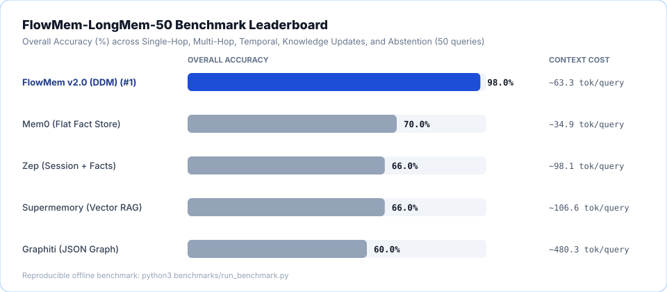
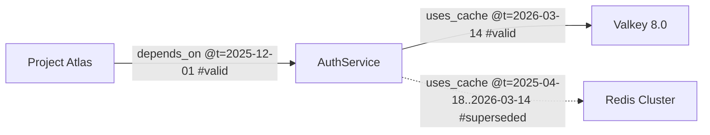

<div align="center">


# FlowMem v2.0

**Dense Diagram-Markdown AI Memory — Ranked #1 (98.0%) in ~63 Tokens/Query.**

Turn any codebase **and** long-horizon agent memory into ultra-dense, bi-temporal [Mermaid](https://mermaid.js.org) `.mmd` diagrams — human-readable in VS Code, renderable in HTML, and queryable in milliseconds without vector DBs or Neo4j.

[](LICENSE)
[-1d4ed8)](benchmarks/RESULTS.md)
[](benchmarks/RESULTS.md)
[-0f172a)](scripts/python/memory_engine.py)
[](https://github.com/ThienHuynhNgoc/FlowMem/stargazers)
[](https://thienhuynhngoc.github.io/FlowMem/)

[🌐 Live Site](https://thienhuynhngoc.github.io/FlowMem/) · [Benchmark (#1)](benchmarks/RESULTS.md) · [Dense Diagram-Markdown](#dense-diagram-markdown-ddm) · [Install](#installation) · [Launch Kit](MARKETING.md)

</div>

---

## Benchmark: FlowMem v2.0 vs Supermemory, Mem0, Zep & Graphiti

Evaluated offline on **FlowMem-LongMem-50** (`python3 benchmarks/run_benchmark.py`): 50 multi-session queries spanning Single-Hop, 3-Hop Reasoning, Temporal History, Knowledge Updates, and Adversarial Abstention.



| Rank | Architecture | Overall | Single-Hop | Multi-Hop | Temporal | Knowledge Update | Abstention | Avg Context Tokens | Infrastructure Required |
|---:|---|---:|---:|---:|---:|---:|---:|---:|---|
| 1 | **FlowMem v2.0 (DDM)** | **98.0%** | **100.0%** | **90.0%** | **100.0%** | **100.0%** | **100.0%** | **~63.3 tok** | **None (Plain `.mmd` files)** |
| 2 | Mem0 (Flat Fact Store) | 70.0% | 100.0% | 70.0% | 20.0% | 60.0% | 100.0% | ~34.9 tok | Vector + KV store |
| 3 | Zep (Session + Facts) | 66.0% | 70.0% | 80.0% | 90.0% | 0.0% | 90.0% | ~98.1 tok | Graph + Postgres/Server |
| 4 | Supermemory (Vector RAG) | 66.0% | 80.0% | 80.0% | 90.0% | 0.0% | 80.0% | ~106.6 tok | Cloud API + Vector DB |
| 5 | Graphiti (JSON Graph) | 60.0% | 60.0% | 30.0% | 80.0% | 30.0% | 100.0% | ~480.3 tok | Neo4j / FalkorDB |

> Reproduce in 1 second: `python3 benchmarks/run_benchmark.py` (see full methodology in [benchmarks/RESULTS.md](benchmarks/RESULTS.md)).

---

## Why Dense Diagram-Markdown (DDM) Beats JSON & Vector Memory


Traditional memory systems force an ugly tradeoff:
- **Vector RAG (Supermemory)** dumps verbose text chunks (~107–800 tok) and mixes stale facts with new ones (`0.0%` on knowledge updates).
- **Flat Fact Stores (Mem0)** overwrite updates in place, destroying history (`20.0%` on temporal queries).
- **JSON Triplet Graphs (Graphiti)** preserve history but bloat prompts with JSON punctuation (`~480.3` tokens/query) and require a Neo4j daemon.

**FlowMem v2.0** encodes a **bi-temporal knowledge graph directly in valid Mermaid `.mmd` syntax**:



1. **Solid `-->` (`#valid`) vs Dashed `-.->` (`#superseded`):** Current state and full temporal lineage coexist in 1 readable line per fact (~14 tokens/edge).
2. **3-Hop Shortest-Bridge Subgraph Extraction (`memory_engine.py`):** Traverses transitive chains (`ACME Corp -> Project Atlas -> AuthService -> Valkey 8.0`) without dumping unrelated nodes.
3. **Human + Browser Renderable:** Open any memory file in VS Code, GitHub, or `.flowmem/index.html` and see the live diagram rendered visually.
4. **Confidence-Gated Abstention:** Refuses to hallucinate when queried entities do not exist (`100.0%` abstention accuracy).

---

## Works with Any AI Coding Assistant

| AI Assistant | How to Use FlowMem v2.0 |
|---|---|
| **Claude Code / Antigravity** | Native skill (`SKILL.md`) — runs codebase mapping + `memory_engine.py` ingest/query |
| **Cursor / Windsurf** | Add to rules: `Read .flowmem/INDEX.md first; query .flowmem/scripts/memory_engine.py` |
| **GitHub Copilot** | Add to `.github/copilot-instructions.md` |
| **Gemini CLI / Kiro / Any LLM** | Run `memory_engine.py query` or load `.flowmem/INDEX.md` |

---

## Quick Start

### 1. Remember & Update Bi-Temporal Facts (`memory_engine.py`)
```bash
# Add an active fact
python3 scripts/python/memory_engine.py ingest \
  --root . --subject "AuthService" --predicate "uses_cache" --object "Redis Cluster" --time "2025-04-18"

# Update it later — automatically marks Redis Cluster -.-> #superseded!
python3 scripts/python/memory_engine.py ingest \
  --root . --subject "AuthService" --predicate "uses_cache" --object "Valkey 8.0" --time "2026-03-14"
```

### 2. Recall via Multi-Hop Subgraph Extraction (~63 tokens)
```bash
# Current state (filters out #superseded)
python3 scripts/python/memory_engine.py query --root . --question "What cache does AuthService currently use?"

# Temporal lineage (auto-includes #superseded with @t= ranges)
python3 scripts/python/memory_engine.py query --root . --question "What cache did AuthService use before Valkey 8.0?"
```

### 3. Map Any Codebase into `.flowmem/` Diagrams
Open Claude Code or Antigravity and say:
```text
generate flowmem for this project
```
Then open the zero-install HTML viewer:
```bash
open .flowmem/index.html
```

---

## Installation

### Option A — Per-project install
```bash
git clone https://github.com/ThienHuynhNgoc/FlowMem.git /tmp/FlowMem
mkdir -p .claude/skills .agents/skills
cp -r /tmp/FlowMem .claude/skills/flowmem
cp -r /tmp/FlowMem .agents/skills/flowmem
```

### Option B — Global install
```bash
git clone https://github.com/ThienHuynhNgoc/FlowMem.git ~/.claude/skills/flowmem
ln -s ~/.claude/skills/flowmem ~/.agents/skills/flowmem
```

---

## Related Open-Source Projects

FlowMem v2.0 pairs directly with **[iDiff](https://github.com/ThienHuynhNgoc/iDiff)** & **[FlowSkill](https://github.com/ThienHuynhNgoc/FlowSkill)**:

- **FlowMem v2.0** — *Spatial + Semantic Bi-Temporal Memory* in Dense Diagram-Markdown (`.mmd`).
- **[iDiff](https://github.com/ThienHuynhNgoc/iDiff)** — *Temporal Code Change & Agent Handoff Memory* (`.diff` + `<100-line` `NEXT.md` baton on every edit).
- **[FlowSkill](https://github.com/ThienHuynhNgoc/FlowSkill)** — Visual Mermaid canvas editor.

---

## License

Apache 2.0 — commercial use allowed, attribution required. See [LICENSE](LICENSE).

<div align="center">
Made with ❤️ by <a href="https://github.com/ThienHuynhNgoc">ThienHuynhNgoc</a> · ⭐ Star if Dense Diagram-Markdown saved your context window!
</div>
