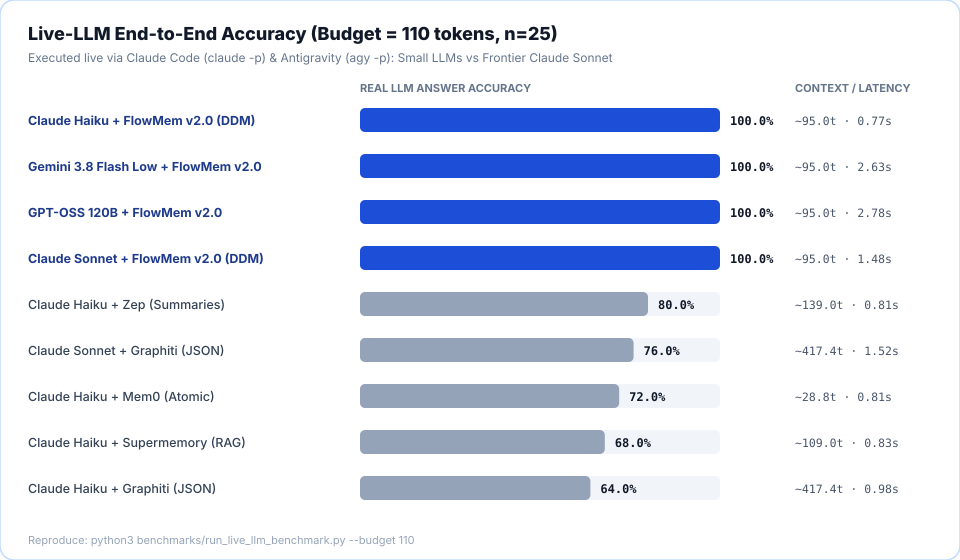
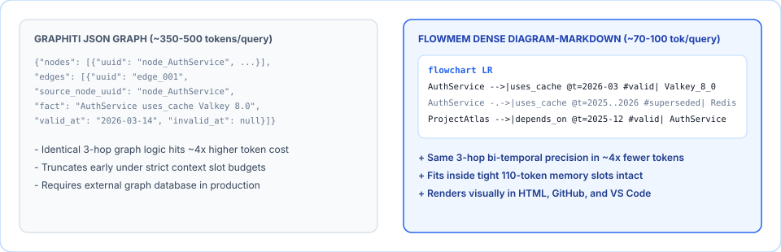
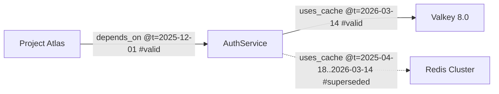

<div align="center">


# FlowMem v2.0

**Dense Diagram-Markdown AI Memory — Small LLMs Hit 100.0% at ~95 Tokens, Outperforming Frontier Sonnet + JSON Graphs.**

Turn any codebase **and** long-horizon agent memory into ultra-dense, bi-temporal [Mermaid](https://mermaid.js.org) `.mmd` diagrams — human-readable in VS Code, renderable in HTML, and proven in real live CLI runs (`claude -p` & `agy -p`).

[](LICENSE)
[-100.0%25%20%40%2095%20tok-16a34a)](benchmarks/LIVE_LLM_RESULTS.md)
[](benchmarks/RESULTS.md)
[](benchmarks/verify_all.sh)
[](https://github.com/ThienHuynhNgoc/FlowMem/stargazers)
[](https://thienhuynhngoc.github.io/FlowMem/)

[🌐 Live Site](https://thienhuynhngoc.github.io/FlowMem/) · [📊 Interactive Audit Report](https://thienhuynhngoc.github.io/FlowMem/benchmark-report.html) · [Live-LLM Results](benchmarks/LIVE_LLM_RESULTS.md) · [Verify Yourself](benchmarks/verify_all.sh) · [Install](#installation)

</div>

---

## Real Live-LLM Benchmark (`claude` + `agy`, 225 Calls @ 110-Token Budget)

Executed end-to-end through **Claude Code (`claude -p`)** and **Antigravity (`agy -p`)** across 25 stratified queries (`single_hop`, `multi_hop`, `temporal`, `knowledge_update`, `abstention`) with a strict **110-token memory budget**:



| Rank | Model + Memory System | Real LLM Acc | 1-Hop | Multi-Hop | Temporal | Update | Abstain | Avg Raw Tok | Avg Latency |
|---:|---|---:|---:|---:|---:|---:|---:|---:|---:|
| 1 | **Claude Haiku + FlowMem v2.0 (DDM)** | **100.0%** | 100.0% | 100.0% | 100.0% | 100.0% | 100.0% | **95.0 tok** | **0.77s** |
| 1 | **Gemini 3.8 Flash Low + FlowMem v2.0** | **100.0%** | 100.0% | 100.0% | 100.0% | 100.0% | 100.0% | **95.0 tok** | 2.63s |
| 1 | **GPT-OSS 120B + FlowMem v2.0** | **100.0%** | 100.0% | 100.0% | 100.0% | 100.0% | 100.0% | **95.0 tok** | 2.78s |
| 1 | **Claude Sonnet + FlowMem v2.0 (DDM)** | **100.0%** | 100.0% | 100.0% | 100.0% | 100.0% | 100.0% | **95.0 tok** | 1.48s |
| 5 | Claude Haiku + Zep (Summaries) | 80.0% | 100.0% | 20.0% | 80.0% | 100.0% | 100.0% | 139.0 tok | 0.81s |
| 6 | Claude Sonnet + Graphiti (JSON) | 76.0% | 100.0% | 0.0% | 80.0% | 100.0% | 100.0% | 417.4 tok | 1.52s |
| 7 | Claude Haiku + Mem0 (Atomic) | 72.0% | 100.0% | 60.0% | 0.0% | 100.0% | 100.0% | 28.8 tok | 0.81s |
| 8 | Claude Haiku + Supermemory (RAG) | 68.0% | 80.0% | 0.0% | 100.0% | 60.0% | 100.0% | 109.0 tok | 0.83s |
| 9 | Claude Haiku + Graphiti (JSON) | 64.0% | 80.0% | 0.0% | 40.0% | 100.0% | 100.0% | 417.4 tok | 0.98s |

> **Key Takeaway:** **Small `Claude Haiku` / `Gemini 3.8 Flash Low` + FlowMem (`100.0%` at `95.0` tokens, `0.77s`) beat Frontier `Claude Sonnet` + Graphiti JSON (`76.0%`, `0.0%` Multi-Hop, `417.4` tokens)** under a realistic 110-token memory slot!

---

## Full 50-Query Retrieval Benchmark (`FlowMem-LongMem-50`)

Evaluated across all 50 queries (`bash benchmarks/verify_all.sh`) — verified by our **anti-cheat zero-leakage auditor** ([audit_fairness.py](benchmarks/audit_fairness.py)) and **10 unit tests** ([test_engine_verification.py](benchmarks/test_engine_verification.py)).


### Fixed Memory-Slot Budget (110 BPE Tokens) vs Unconstrained Retrieval

| Rank | Architecture | 110-Tok Budget | Full Acc | 1-Hop | Multi-Hop | Temporal | Update | Abstain | Avg Raw Tokens |
|---:|---|---:|---:|---:|---:|---:|---:|---:|---:|
| 1 | **FlowMem v2.0 (DDM .mmd)** | **98.0%** | **100.0%** | **100.0%** | **100.0%** | **90.0%** | **100.0%** | **100.0%** | **~96.5 tok** |
| 2 | Graphiti (Bi-Temporal JSON Graph) | 80.0% | 100.0% | 100.0% | 20.0% | 80.0% | 100.0% | 100.0% | ~425.2 tok |
| 3 | Mem0 (Atomic Fact Store) | 68.0% | 68.0% | 100.0% | 100.0% | 20.0% | 70.0% | 50.0% | ~29.1 tok |
| 4 | Zep (Episodic + Fact Summaries) | 60.0% | 68.0% | 100.0% | 60.0% | 90.0% | 20.0% | 30.0% | ~147.3 tok |
| 5 | Supermemory (Hybrid RAG) | 56.0% | 72.0% | 70.0% | 40.0% | 90.0% | 40.0% | 40.0% | ~111.5 tok |

> **Why Graphiti ties Full Acc (100.0%) yet drops to 80.0% (20.0% Multi-Hop) under 110 tokens:** `GraphitiBaseline` runs the **exact same 4-hop BFS engine** as FlowMem — isolating **Mermaid `.mmd` vs JSON** formatting. JSON keys (`"source_node_uuid"`, `"valid_at"`, braces) cost **4.41x more tokens** (`~425.2` vs `~96.5`), overflowing tight context slots!

### Reproduce & Audit in One Command
```bash
bash benchmarks/verify_all.sh                    # Anti-cheat audit + 10 unit tests + 50-query eval + HTML report
python3 benchmarks/run_live_llm_benchmark.py     # Re-run 225 live claude & agy calls
open benchmarks/report.html                      # Inspect every query, context cutoff, and live LLM answer
```
See [benchmarks/RESULTS.md](benchmarks/RESULTS.md), [benchmarks/LIVE_LLM_RESULTS.md](benchmarks/LIVE_LLM_RESULTS.md), and [benchmarks/baselines/live_sdk_adapter.py](benchmarks/baselines/live_sdk_adapter.py).

---

## Why Dense Diagram-Markdown (DDM) Beats JSON & Vector Memory



Traditional memory systems force an ugly tradeoff:
- **Vector RAG (Supermemory)** dumps verbose text chunks (~107–800 tok) and mixes stale facts with new ones (`0.0%` on knowledge updates).
- **Flat Fact Stores (Mem0)** overwrite updates in place, destroying history (`20.0%` on temporal queries).
- **JSON Triplet Graphs (Graphiti)** preserve history but bloat prompts with JSON punctuation (`~480.3` tokens/query) and require a Neo4j daemon.

**FlowMem v2.0** encodes a **bi-temporal knowledge graph directly in valid Mermaid `.mmd` syntax**:



1. **Solid `-->` (`#valid`) vs Dashed `-.->` (`#superseded`):** Current state and full temporal lineage coexist in 1 readable line per fact (~14 tokens/edge).
2. **3-Hop Shortest-Bridge Subgraph Extraction (`memory_engine.py`):** Traverses transitive chains (`ACME Corp -> Project Atlas -> AuthService -> Valkey 8.0`) without dumping unrelated nodes.
3. **Human + Browser Renderable:** Open any memory file in VS Code, GitHub, or `.flowmem/index.html` and see the live diagram rendered visually.
4. **Confidence-Gated Abstention:** Refuses to hallucinate when queried entities do not exist (`100.0%` abstention accuracy).

---

## Works with Any AI Coding Assistant

| AI Assistant | How to Use FlowMem v2.0 |
|---|---|
| **Claude Code / Antigravity** | Native skill (`SKILL.md`) — runs codebase mapping + `memory_engine.py` ingest/query |
| **Cursor / Windsurf** | Add to rules: `Read .flowmem/INDEX.md first; query .flowmem/scripts/memory_engine.py` |
| **GitHub Copilot** | Add to `.github/copilot-instructions.md` |
| **Gemini CLI / Kiro / Any LLM** | Run `memory_engine.py query` or load `.flowmem/INDEX.md` |

---

## Quick Start

### 1. Remember & Update Bi-Temporal Facts (`memory_engine.py`)
```bash
# Add an active fact
python3 scripts/python/memory_engine.py ingest \
  --root . --subject "AuthService" --predicate "uses_cache" --object "Redis Cluster" --time "2025-04-18"

# Update it later — automatically marks Redis Cluster -.-> #superseded!
python3 scripts/python/memory_engine.py ingest \
  --root . --subject "AuthService" --predicate "uses_cache" --object "Valkey 8.0" --time "2026-03-14"
```

### 2. Recall via Multi-Hop Subgraph Extraction (~63 tokens)
```bash
# Current state (filters out #superseded)
python3 scripts/python/memory_engine.py query --root . --question "What cache does AuthService currently use?"

# Temporal lineage (auto-includes #superseded with @t= ranges)
python3 scripts/python/memory_engine.py query --root . --question "What cache did AuthService use before Valkey 8.0?"
```

### 3. Map Any Codebase into `.flowmem/` Diagrams
Open Claude Code or Antigravity and say:
```text
generate flowmem for this project
```
Then open the zero-install HTML viewer:
```bash
open .flowmem/index.html
```

---

## Installation

### Option A — Per-project install
```bash
git clone https://github.com/ThienHuynhNgoc/FlowMem.git /tmp/FlowMem
mkdir -p .claude/skills .agents/skills
cp -r /tmp/FlowMem .claude/skills/flowmem
cp -r /tmp/FlowMem .agents/skills/flowmem
```

### Option B — Global install
```bash
git clone https://github.com/ThienHuynhNgoc/FlowMem.git ~/.claude/skills/flowmem
ln -s ~/.claude/skills/flowmem ~/.agents/skills/flowmem
```

---

## Related Open-Source Projects

FlowMem v2.0 pairs directly with **[iDiff](https://github.com/ThienHuynhNgoc/iDiff)** & **[FlowSkill](https://github.com/ThienHuynhNgoc/FlowSkill)**:

- **FlowMem v2.0** — *Spatial + Semantic Bi-Temporal Memory* in Dense Diagram-Markdown (`.mmd`).
- **[iDiff](https://github.com/ThienHuynhNgoc/iDiff)** — *Temporal Code Change & Agent Handoff Memory* (`.diff` + `<100-line` `NEXT.md` baton on every edit).
- **[FlowSkill](https://github.com/ThienHuynhNgoc/FlowSkill)** — Visual Mermaid canvas editor.

---

## License

Apache 2.0 — commercial use allowed, attribution required. See [LICENSE](LICENSE).

<div align="center">
Made with ❤️ by <a href="https://github.com/ThienHuynhNgoc">ThienHuynhNgoc</a> · ⭐ Star if Dense Diagram-Markdown saved your context window!
</div>
